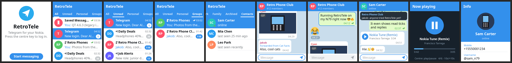

# RetroTele

A small Telegram client for **Nokia S60 3rd Edition** phones (written and tested for the Nokia N79), in Python for S60 1.4.5.

Modern Symbian Telegram apps such as Symbigram need Qt Quick Components (Symbian^3/Anna/Belle), so they don't install on S60 3rd Edition. RetroTele speaks Telegram's MTProto 2.0 protocol itself, so it doesn't need a PC, a bridge or a proxy. SHA-1, SHA-256, SHA-512, AES-IGE, Diffie-Hellman and the TL serializer are all pure Python 2.2.



## Features

- Telegram-style look: blue header, round avatars (initials or the chat's photo thumbnail), unread badges, online dots, chat bubbles, read ticks
- Tabs: **All, Unread, Personal, Groups, Channels**, your own Telegram folders, **Archived** and **Contacts**. Switch with left/right.
- Log in with your phone number and the code Telegram sends you, including the two-step verification password
- Read chats and load older messages automatically by scrolling up. Replies, forwards and media show as labels such as `Photo`, `Voice message 0:04` and `Sticker`.
- Write messages and reply to a selected one. Any number key in a chat starts a message.
- Live incoming messages with a pop-up banner (muted chats stay quiet), plus read receipts and online status
- Search your chats and contacts, or open any @username
- **Call** a contact's phone number as a normal phone call
- The chat list is cached, so it appears instantly when the app starts

There's no media download, secret chats, or **Telegram** voice/video calls. Those need real-time audio streaming with the Opus codec, which Python for S60 1.4.5 can't do, so "Call" uses the normal phone line.

### Keys

| Where | Key | Does |
|---|---|---|
| Chat list | Up/down | Move |
| Chat list | Left/right | Switch tab |
| Chat list | Centre | Open chat |
| Chat | Up/down | Select message (scrolling up loads older ones) |
| Chat | Centre | On a message: reply / read in full. On the input bar: write |
| Chat | Any number key | Write a message |
| Chat | Left or right softkey | Back to chats |

## Install

1. Install **Python for S60 1.4.5** (`PythonForS60_1_4_5_3rdEd.sis`) if it's not on the phone yet.
2. Install `RetroTele.sis`.
3. On a computer, open <https://my.telegram.org>, go to **API development tools** and create an app. Note the **api_id** and **api_hash**.
4. Open RetroTele and enter api_id and api_hash once. Choose an access point (Wi-Fi or packet data), then log in.

The first connection creates a secure key with Telegram, which takes a few seconds of 2048-bit math on the phone. After that, start-up is quick. Data lives in `E:\RetroTele\` (session, settings). The log is `E:\retrotele_log.txt`.

### Two-step verification

If your account has a cloud password, Telegram wants a hash made with 100,000 rounds of PBKDF2-SHA512. In pure Python on an N79, that takes roughly an hour. You have two options:

- **Enter password (phone)**: keep RetroTele open on the charger and watch the progress in the title bar.
- **Use hash from PC helper**: RetroTele writes `RetroTele\2fa_salts.txt` to the memory card. Connect the phone as mass storage and run `python3 tools/tg2fa.py /path/to/card/RetroTele`, then type the password. Back on the phone, select **Continue**.

This is needed only once, at login.

## Build and test (Linux)

```sh
tools/setup.sh                 # private Python 2.7 + Ensymble (once)
sh pys60/tests/run.sh          # Python 2.2 checks + PC tests (LIVE=1 also talks to Telegram)
sh pys60/tests/preview/preview.sh out/   # PNG screenshots of every screen (python3 + Pillow)
sh pys60/build_sis.sh          # -> pys60/dist/RetroTele.sis
```

`schema/make_schema.py` regenerates `pys60/schema.txt` from Telegram Desktop's `api.tl` and `mtproto.tl` (currently layer 233).

The PyS60 networking pitfalls (main-thread sockets, never `close()`) are the same as in [RetroSend](https://github.com/manojanasuri16/RetroSend/blob/main/docs/PYS60-NOTES.md). Crypto code follows the Python 2.2 integer rules described at the top of `pys60/tgcrypto.py`, which `tools/check_ints.py` enforces.
